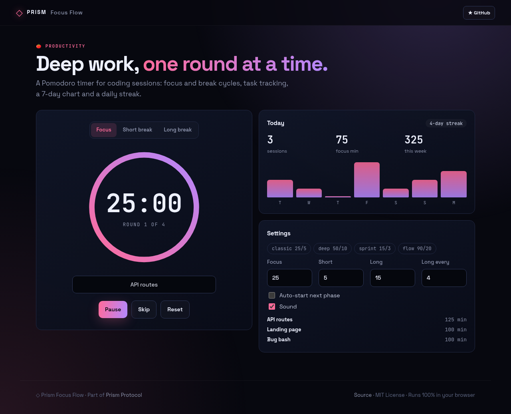
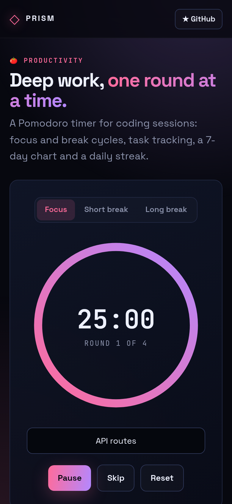

<!-- ═════════════ HEADER ═════════════ -->
<p align="center">
  
</p>

<p align="center">
  
</p>

<p align="center">
  <a href="https://github.com/krishyaa06/prism-focus-flow/actions/workflows/ci.yml"></a>
  <a href="https://krishyaa06.github.io/prism-focus-flow/"></a>
  
  
  <a href="LICENSE"></a>
</p>

<p align="center">
  
</p>


## ⚡ Overview

**Prism Focus Flow** is a Pomodoro timer built for coding sessions. Pick a preset (classic 25/5, deep 50/10, sprint 15/3, flow 90/20) or set your own, name the task you're on, and let it cycle between focus, short and long breaks. Completed sessions are logged locally, so you get today's totals, a 7-day chart, a streak and the tasks you spent the most time on. Timing is based on timestamps, so it doesn't drift in background tabs and survives reloads.

## ✨ Features

- **Focus / short / long** cycles with configurable long-break interval
- **4 presets** + custom minutes; optional auto-start
- **Progress ring**, live tab-title countdown, chime + desktop notification
- **Stats**: today, this week, 7-day bar chart, daily streak
- **Task tracking** — top tasks by focus minutes
- Drift-free timestamps, state saved locally; `Space` to start/pause

## 📸 Screenshots

<table>
  <tr>
    <td width="68%"></td>
    <td width="32%"></td>
  </tr>
</table>

## 🚀 Quick Start

**Use it online:** [https://krishyaa06.github.io/prism-focus-flow/](https://krishyaa06.github.io/prism-focus-flow/)

**Run locally:**

```bash
git clone https://github.com/krishyaa06/prism-focus-flow.git
cd prism-focus-flow
# open index.html in your browser, or serve it:
npx serve .
```

## 🛠️ Usage

Type what you're working on, press **Start** (or `Space`). When the ring empties you'll hear a chime and move to a break. Change presets or minutes under **Settings**.

## 📁 Project Structure

```text
prism-focus-flow/
├── assets/
│   ├── logo.png
│   └── logo.svg
├── css/
│   ├── app.css
│   └── prism.css
├── js/
│   ├── app.js   # timer loop, notifications, charts
│   ├── core.js   # cycle logic, formatting, stats — tested in Node
│   └── prism.js
├── test/
│   └── core.test.js
├── .gitignore
├── LICENSE
├── README.md
├── index.html
└── package.json
```

## 🧪 Tests

```bash
npm test
```

Tests use the built-in `node:test` runner, so there is nothing to install. CI runs them on Node 20 and 22.

## 🤝 Contributing

1. Fork the repo and create a branch: `git checkout -b feature/my-idea`
2. Make your change and add a test in `test/`
3. Run `npm test` and open a Pull Request

## 🔷 Part of Prism Protocol

Prism Focus Flow is one of the open-source tools built by [Prism Protocol](https://dc.gg/prismprotocol), a tech community where young builders learn, ship and compete together.

## 👤 Author

<table>
  <tr>
    <td align="center">
      <a href="https://github.com/krishyaa06"><br><b>Soumya Bhandare</b></a><br>
      <sub>Founder @ Prism Protocol</sub>
    </td>
    <td>
      <a href="https://dc.gg/prismprotocol"></a><br>
      <a href="https://instagram.com/prism_protocol_"></a><br>
      <a href="https://x.com/krishyaa06"></a>
    </td>
  </tr>
</table>

## 📄 License

Released under the [MIT License](LICENSE).

<p align="center">
  <b>If you like this project, consider giving it a ⭐</b><br>
  <sub>"Build. Create. Compete." · Made with ⚡ by Prism Protocol</sub>
</p>


